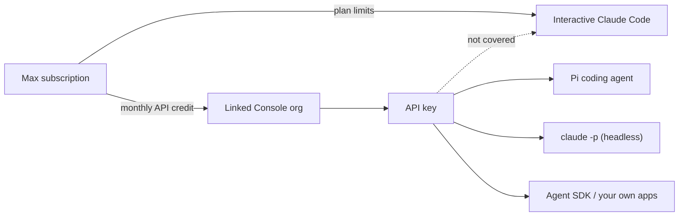

## The Situation

My Anthropic Max subscription comes with **$100 of API credit every month**. That's handy, because I usually hit the plan's weekly usage limit before the week is over, and the credit is a natural way to keep going until the limit resets.

So I created an API key, pointed Claude Code at it, and got an error telling me my credit balance was too low. Anthropic documents the message as:

```text
Credit balance too low · Add funds: https://platform.claude.com/settings/billing
```

To my surprise, **the API credit can't be used in Claude Code itself.** It isn't a balance problem. Claude Code just isn't something the credit pays for.

The workaround I've settled on is the [Pi coding agent](https://github.com/earendil-works/pi). Pi runs on a plain Anthropic API key, so the credit covers it. This post shows how to claim the credit, why Claude Code rejects it, and how to set up Pi so the $100 doesn't expire unused.

## Why Claude Code Rejects the Credit

This isn't a bug. Anthropic's [API credits documentation](https://platform.claude.com/docs/en/about-claude/api-credits-for-subscribers) has a table of what the credits cover:

| Covered                                     | Not covered                                         |
| ------------------------------------------- | --------------------------------------------------- |
| Claude API (Messages and Message Batches)   | Claude Code                                         |
| Claude Managed Agents                       | Extra usage in the Claude apps                      |
| Claude Agent SDK                            | Bedrock, Vertex, Foundry, Claude Platform on AWS    |
| Console Playground                          |                                                     |

When an organization holds *only* these credits and Claude Code sends a request, the docs say you get exactly the `Credit balance too low` message above.

There's one nuance worth knowing. The [help center article](https://support.claude.com/en/articles/17154008-monthly-api-credits-for-max-ultra-and-team-plans) clarifies that only **interactive** Claude Code (terminal, IDE, desktop, web) is excluded. Running `claude -p` yourself with an API key from the linked organization **is** covered, and so is the Agent SDK. Runs started by the Claude Code GitHub Action, an IDE extension, or the desktop app count as Claude Code usage and aren't covered.

So the credit works for headless scripts, but not for the interactive agent you actually want when your weekly limit runs out. That's the gap Pi fills.



## Step 1: Claim Your Credit

The credit isn't applied automatically. You link your plan to a Claude Console organization once, and credit lands there every billing cycle.

| Plan  | Monthly API credit |
| ----- | ------------------ |
| Max   | $100               |
| Ultra | $200               |
| Team  | $20 per Standard seat, $100 per Premium seat (pooled, capped at $500) |

Free, Pro and Enterprise plans don't get it.

To claim it:

1. On claude.ai, open **Settings > Billing** (Team: **Organization settings > Billing**).
2. In the **API credits** section, pick an existing Console organization or create one.
3. Click **Link organization** and accept the Supplemental Credit Terms.

If you don't see an **API credits** section, you aren't eligible yet. New subscribers have to wait 7 days before they can claim. If you bought your plan in the iOS or Android app, it still qualifies, but you have to claim on claude.ai in a browser. You don't need a payment method on file in the Console.

> **The link is permanent.** Each plan links to one Console organization, and you can't change it yourself. Only support can. Link the organization you actually plan to build in.
{: .prompt-warning }

Once linked, the credit shows up in the Console at [platform.claude.com/settings/billing](https://platform.claude.com/settings/billing) under **Promotional credits**, with its amount and expiry date.

## Step 2: Create a Workspace and API Key

Every API key and workspace in the linked organization draws from the same balance. I like to give Pi its own workspace with a spend limit so one runaway session can't eat the whole month:

1. In the Console, create a workspace (I called mine `pi`) and set a spend limit on it.
2. Create an API key in that workspace and copy it.

## Step 3: Install Pi

[Pi](https://github.com/earendil-works/pi) is an open-source (MIT) "minimal, extensible AI agent harness" with a coding agent on top. I've written about it before: it's the tool that showed me how to [run Claude Code on a Muse Spark subscription](/posts/using-claude-code-with-muse-spark-subscription/).

Install it with the official script on macOS or Linux:

```bash
curl -fsSL https://pi.dev/install.sh | sh
```

Or, if you'd rather not pipe a script into your shell, use npm (Pi needs Node.js 22.19 or newer):

```bash
npm install -g --ignore-scripts @earendil-works/pi-coding-agent
```

On Windows:

```powershell
powershell -c "irm https://pi.dev/install.ps1 | iex"
```

`pi update` keeps it up to date later.

## Step 4: Log Pi In with Your API Key

Start Pi and run `/login`:

```bash
pi
```

```text
/login
```

Pick **Anthropic**, then choose the **API key** method and paste the key from Step 2. Pi saves it in `~/.pi/agent/auth.json`.

> **Choose the API key, not the Anthropic browser/subscription login.** Pi also offers a subscription login for Anthropic. That bills your plan limits (which you've already used up) instead of the credit. It's also the path Anthropic's terms warn about: OAuth is meant for "ordinary use of Claude Code and other native Anthropic applications", and third-party tools "should use API key authentication through Claude Console".
{: .prompt-danger }

Using `/login` has a nice side effect: the key lives in Pi's own config, not in your shell environment. That matters, because if `ANTHROPIC_API_KEY` is exported globally, interactive Claude Code will offer to use it, and you're back to `Credit balance too low` (see Tips below).

Treat `~/.pi/agent/auth.json` like a password. Pi's docs warn that it "can contain API keys and OAuth tokens. Keep it private and do not commit it."

If you prefer environment variables, scope the key to Pi only with an alias, the same pattern as my [Claude profile aliases](/posts/quick-tip-switching-between-claude-profiles-on-anthropic-and-bedrock/):

```bash
alias pi-credit='ANTHROPIC_API_KEY=$(cat ~/.config/anthropic-credit-key) pi'
```

## Step 5: Pick a Model and Work

Inside Pi, use `/model` to choose a model, or pass one on the command line:

```bash
pi --model sonnet
```

Add a `:<level>` suffix to set the thinking level, for example `pi --model sonnet:high`. `pi --list-models` shows everything available, including Opus 5.5, Sonnet 5.5, Haiku 5.5 and Fable 5.1.

That's it. When my weekly limit runs out, I switch to `pi` and keep working on the credit. To check that the credit is being used, watch the **Promotional credits** balance on the Console Billing page.

## Making $100 Last

An agentic coding session can go through millions of tokens, so model choice matters. Current API prices per million tokens:

| Model      | Input | Output | Cache hit |
| ---------- | ----- | ------ | --------- |
| Haiku 5.5  | $0.10 | $0.50  | $0.01     |
| Sonnet 5.5 | $2    | $10    | $0.10     |
| Opus 5.5   | $4    | $20    | $0.20     |
| Fable 5.1  | $10   | $50    | —         |

Haiku 5.5's price applies to prompts up to 100K tokens ($0.50 / $2.50 above that). Prices are from Anthropic's [pricing page](https://platform.claude.com/docs/en/about-claude/pricing) as of November 2026.

A few things I keep in mind:

- **Default to Sonnet** and switch to Opus only for the hard parts.
- **Use it or lose it.** Credit arrives each billing cycle and unused credit expires at the end of it. Nothing rolls over.
- **The workspace spend limit** from Step 2 is your safety net.

## Tips

**Keep `ANTHROPIC_API_KEY` out of your global shell profile.** When it's set, interactive Claude Code asks once whether to use it and remembers your answer. If you said yes, every `claude` session now goes to the API key and fails with `Credit balance too low`. Run `/status` to see which credential Claude Code is using, flip **Use custom API key** in `/config`, or `unset ANTHROPIC_API_KEY` to go back to your subscription.

**The credit doesn't raise your Claude Code limits.** The docs are explicit: "Credits don't change your usage limits in Claude or Claude Code." It's a separate pool that only API clients like Pi can spend.

**Running out is safe.** When the credit is gone, API requests just stop until the next deposit. Your Claude plan is never charged, unless you've bought extra credits or turned on auto-reload in the Console. Included credits are always spent before purchased ones.

**Don't share the key.** The Supplemental Credit Terms say credits "may only be used by the holder of the Anthropic account" and can't be transferred or sold.

## All Set!

If you're on Max, you already have $100 of API credit a month, and if you've only tried it in Claude Code, you've probably seen `Credit balance too low` and given up. Link your plan to a Console organization, give Pi an API key from it, and that credit becomes a weekly-limit fallback that costs nothing extra. If you want more options, [Muse Spark](/posts/using-claude-code-with-muse-spark-subscription/) and [NVIDIA NIM](/posts/running-claude-code-for-free-with-nvidia-nim/) are still good backups too.
