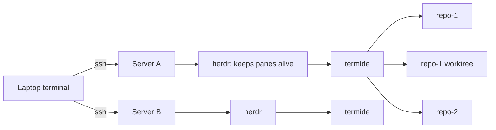

## The Situation

I've been setting up a small "software factory": coding work, much of it done by AI agents, spread across several servers, each with its own repos and git worktrees.

For a while I used **VS Code + code-server**. It worked, but switching between servers, repos and worktrees wasn't efficient.

Lately I've been using [Termide](https://github.com/termide/termide) instead, and it's been genuinely useful. It's a terminal IDE, so it runs right in the ssh session I already have open. It ships with lots of good-looking themes, and it has agent-friendly features built in. This post covers what it is, how to install it, and how it fits my ssh + [herdr](https://herdr.dev) setup.

> Termide is pre-1.0, moves fast (new releases every few days) and is mostly a one-person project. Everything here is **as of version 0.48.0** (released 2026-10-31). Check the [docs](https://github.com/termide/termide/tree/main/doc/en) if something has changed.
{: .prompt-info }

## What Termide Is

Termide describes itself as an "all-in-one terminal workspace for desktops and servers: editor with LSP, file manager with SFTP/FTP, terminal, git, database viewer and a coding agent in one zero-config static Rust binary." It's MIT-licensed.

A heads-up if you go searching: several unrelated GitHub projects are also called "termide", and so is an npm package. The one I'm talking about is [termide/termide](https://github.com/termide/termide), website [termide.github.io](https://termide.github.io).

The "single static binary" part is what makes it work well on servers. SSH, TLS and crypto are pure Rust, so the same file runs on Alpine, in a distroless container or in Termux. It uses git, language servers and a browser when they're present, but doesn't require them.

## Install

On Linux or macOS, the install script detects your system and offers the methods that fit it:

```bash
curl -fsSL https://raw.githubusercontent.com/termide/termide/main/install.sh | sh
```

Other options:

```bash
brew tap termide/termide && brew install termide   # Homebrew
yay -S termide-bin                                 # Arch (AUR)
nix run github:termide/termide                     # Nix
```

There are also .deb and .rpm packages (x86_64), plus tarballs for Linux, macOS and Windows on the [Releases page](https://github.com/termide/termide/releases).

For servers, there's a no-script route. Grab the **static musl** tarball (x86_64 or ARM64), copy the binary over, and run it. In the project's words: "On a server, copy the static musl binary and run it — nothing else needs installing."

```bash
# on your laptop
curl -fsSLO https://github.com/termide/termide/releases/download/0.48.0/termide-0.48.0-x86_64-unknown-linux-musl.tar.gz
tar xzf termide-0.48.0-x86_64-unknown-linux-musl.tar.gz
scp termide my-server:~/.local/bin/   # any directory on your PATH
```

Then open a project:

```bash
termide ~/src/my-repo
```

## Why It Works Better for Multi-Server Work

These are the features that matter most when you're juggling many repos and worktrees.

### Projects keep running in the background

Every repo you open is a **project**, and open projects appear as buttons in the menu bar. From the docs: "Switching to another project leaves the one you were in open in the background: programs in its terminals keep running, agents keep working, and unsaved edits stay as they were."

| Key           | Action                       |
| ------------- | ---------------------------- |
| `Alt+1`…`Alt+9` | Switch to project by number |
| `Alt+\`       | Fuzzy project switcher        |
| `Alt+N`       | Open a new project            |

When you relaunch, the last run's projects reopen around the directory you start in, with each project's panel layout restored. Pass `--no-restore` to skip that.

### 🔔 tells you which project needs you

A 🔔 marks any project "whose panel waits for you (an agent's question or finished work, a terminal bell)", and switching to it moves focus straight to the waiting panel. When agents are working in several repos at once, that's exactly the signal you want.

### The git panel understands worktrees

The git panel does status, a log with a coloured commit graph, diff, staging, stash, blame, and branches with their worktrees. In the branch selector, `●` marks the branch checked out in the main copy and `⧉` marks one checked out in a linked worktree. Pick a worktree's branch and the panel shows *that* working copy's changes, and staging, commit, diff, push and pull all act there.

### Remote files without a mount

The dual-pane file manager speaks SFTP, FTP and FTPS, so you can copy between a local panel and a remote one directly. Saved passwords go into an encrypted vault.

### And the rest

There's also an editor with LSP for 23 languages (with optional Vim mode), a debugger (DAP), a database viewer for SQLite, Postgres and MySQL, Markdown/Mermaid/HTML preview, a resource monitor, and a `Ctrl+P` command palette. There's no telemetry and it doesn't check for updates.

## The Themes

Termide looks good, too. It ships with **44 built-in themes** in four groups:

- **Dark:** `dracula`, `monokai`, `nord`, `onedark`, `catppuccin-macchiato`, `everforest`, `gruvbox`, `kanagawa`, `rosepine`, `tokyonight`, `github-dark`, and the default, `windows-xp`
- **Light:** `github-light`, `solarized-light`, `ayu-light`, `material-lighter`
- **Retro:** `norton-commander`, `far-manager`, `dos-navigator`, `volkov-commander`, `windows-95`, `windows-98`
- **Cinematic:** `matrix`, `pip-boy`, `terminator`

Go to **Options → Themes** to switch. Each entry shows a colour preview and applies immediately. You can also set it in `~/.config/termide/config.toml`:

```toml
theme = "tokyonight"
```

Settings (`Alt+P`) can also store a theme **per project** (`Stored: Project`, saved in `<project>/.termide/config.toml`). One idea for a multi-server setup: give each server's projects a different theme, so you can tell at a glance which machine you're on. You can also write your own themes in TOML.

## My Setup: ssh + herdr

I don't run Termide on its own. I ssh into each server and run it inside [herdr](https://herdr.dev), a "terminal workspace manager for AI coding agents". Like tmux, herdr keeps a background server running, so panes survive detaches and dropped ssh connections, and it shows the state of the coding agents running in its panes in a sidebar.



The layering is simple: herdr owns the session, and Termide is the IDE inside it.

```bash
ssh my-server
herdr                       # or, from your laptop: herdr --remote my-server
termide ~/src/my-repo       # then Alt+N / Alt+\ / Alt+1..9 to move between projects
```

The keys stay out of each other's way. herdr's default prefix is `ctrl+b`, and Termide's documented shortcuts are almost all `Alt+…` plus `Ctrl+P`, `Ctrl+G` and `Ctrl+\`. One caveat from Termide's FAQ: on macOS, the Alt hotkeys need a terminal that supports the Kitty keyboard protocol.

### Not using herdr? Termide can detach on its own

Termide's FAQ says it can replace tmux "for keeping work alive over SSH" (and it also runs fine inside tmux). On Unix:

```bash
termide --detached          # start a detachable instance; Alt+D detaches
termide --list-instances
termide --attach            # reattach later
```

"Close the SSH connection, come back hours later, attach again — the editors, shells, LSP servers and long-running jobs are exactly where you left them." One catch: a Termide started normally can't be detached later. Set `always_detachable = true` under `[general]` in the config if you want every launch to be detachable.

Inside herdr you mostly don't need this, since herdr already keeps the pane alive. It's handy if you attach to Termide from outside herdr.

## Coming Next: Agents

Termide's agent-friendly features are the part I haven't explored yet. Out of the box there's a built-in agent panel (`Alt+A`) that can talk to Anthropic or any OpenAI-compatible endpoint. According to the docs, it can also drive Claude Code, Codex or Gemini CLI over the Agent Client Protocol. It also reads skills from `.agents/skills/`, "so a skill written for Claude Code, Codex or pi works unchanged."

How well that works with my own Claude Code and [pi](https://github.com/earendil-works/pi) agents is something I'll try out and share in my next post.

## Wrap-Up

If your work is spread across several servers, repos and worktrees, a terminal IDE that lives in your ssh session makes moving between them a lot smoother than it was for me with code-server. Termide gives you that in one static binary: background projects you switch between with `Alt+1..9`, 🔔 when one needs you, a worktree-aware git panel, and 44 themes to make it look good. Drop it on a server, run it inside herdr, and see if it fits your workflow too.
